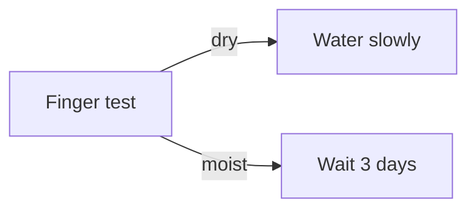

# Writing slides for Slidecko

Slidecko is a presentation editor that runs entirely in the browser. It reads [Slidev](https://sli.dev) Markdown plus a few `data-*` blocks for its own elements. You write the deck as text; the user then edits it visually, presents it (presenter view, pen, laser, timers, quizzes, name picker) and exports it to PowerPoint, Google Slides, OpenDocument, PDF, images, one HTML file or back to Slidev.

Everything below is what Slidecko's import reads. Do not invent other syntax: unknown Vue components, `<style>` and `<script>` are removed.

## Hand it over

Write one file, `slides.md`, then tell the user how to open it:

- **New project**: on the start page of [slidecko.de](https://slidecko.de) choose "Open Markdown" (or "Open Slidecko / Slidev project" for a folder with `slides.md` and its pictures).
- **Into an open project**: Insert → "Markdown / AI slides …" (⇧M), paste, "Insert slides".

Nothing is uploaded; the deck stays in the user's browser.

## Deck and slides

- `---` on its own line separates slides. A `key: value` block between two `---` right after a separator is that slide's frontmatter. The first block of the file is the headmatter of the deck and the first slide's frontmatter.
- **Headmatter**: `title:`, `aspectRatio: 16/9` (or `4/3`), `transition: fade` (also `slide-left`, `slide-up`, `none`), `duration: 20min` (planned talk length for rehearsing), `colorSchema: dark` (dark theme) or `theme: seriph` (serif paper theme). The user picks one of 13 themes in the editor anyway; do not style slides yourself.
- **Layouts** (`layout:`): `cover` (title slide), `intro`, `section` (chapter), `statement`, `fact` (one big number), `quote`, `center` and `end` are centred; `default` (or none) is a title with content. For two columns use the grid below, not Slidev's `two-cols` slots.
- **Per slide**: `transition:`, `hide: true` (skipped when presenting and exporting), `hideInToc: true`, `plannedTime: 90` (seconds, for rehearsing), `title:` and `level:` (its entry in the table of contents).
- **Speaker notes**: an HTML comment as the very last thing on the slide, `<!-- … -->`. A `[click]` in the notes starts the part for the next click step. Write notes generously: what to say, not what is on the slide.

## Content

- **Text**: `#` is the slide title; `##`/`###` sub-headings, paragraphs, bullet and numbered lists, **bold**, *italic*, `inline code`, [links](https://example.org), block quotes, tables (GFM).
- **Link to a slide**: `<Link to="5">Back to the plan</Link>` (keeps pointing at that slide when slides move).
- **Code**: fenced with a language, ` ```js `. Step through lines with ` ```js {2|4-5|all} `; ` ```js {monaco-run} ` makes JavaScript runnable on the slide.
- **Diagram**: a ` ```mermaid ` block (flowchart, sequence, gantt, pie, mindmap …) becomes an editable diagram.
- **Formulas**: `$…$` in a line, `$$…$$` on a line of its own, in TeX (KaTeX). Write `\$` for a dollar sign.
- **Columns**: blank lines inside each `<div>`, so the Markdown in it is read:

  ```html
  <div class="grid grid-cols-2 gap-8">
  <div>

  Left Markdown

  </div>
  <div>

  Right Markdown

  </div>
  </div>
  ```

- **Callout**: `<div data-callout="info">` (also `tip`, `warn`, `danger`), a blank line, `**Note:** text`, a blank line, `</div>`.
- **Hand-drawn mark** on words: `<span v-mark.circle.orange="1">words</span>`. Marks: `underline`, `circle`, `box`, `highlight`, `strike-through`, `crossed-off`, `bracket`; colours: `red`, `orange`, `yellow`, `lime`, `green`, `teal`, `cyan`, `blue`, `indigo`, `purple`, `pink`, `gray`, `black`, `white`; `="1"` draws it on click 1 (leave it out to draw it at once).
- **Icon**: `<lucide-sprout />` on a line of its own. Sets: `lucide`, `tabler`, `mdi`, `carbon`, `ph` (Phosphor), names as on [icones.js.org](https://icones.js.org). Unknown names are dropped, so use common ones.
- **Arrow** pointing at something: `<Arrow x1="620" y1="300" x2="760" y2="220" />` in slide coordinates (980 × 552 at 16:9, from the top left corner); optional `two-way`, `width="4"`, `color="#dc2626"`. Use sparingly, the layout may move text.
- **YouTube**: `<Youtube id="VIDEO_ID_11" />` with the 11-character id from the video link.
- **Pictures**: `` with a path inside the project folder (or its `public/`), and the same kind of path for `background: images/plant.jpg` in a slide's frontmatter (`backgroundDim: 40` darkens it). Pictures from the web are not downloaded: without files, leave pictures out and tell the user where one would help (Insert → Image in the editor).

## Click steps

- `<v-click>` … `</v-click>` (blank lines inside) shows a block on the next click; `<v-click at="3">` on click 3; `<v-after>` together with the previous click; `<v-click hide>` hides it from that click on.
- `<v-clicks>` around a list shows its items one by one.
- `<div v-click>` is not read; use the tags.

## Slidecko's own elements

They are not part of Slidev, so they are written as `data-*` blocks. JSON goes into single-quoted attributes; write an apostrophe inside as `&#39;`.

- **Table of contents**: `<Toc />` lists the slide titles. With a style: `<div data-toc='{"look":"cards","columns":2}'></div>`, `look` `numbered`, `cards` or `lines`.
- **Timer**: `<div data-timer="300"></div>`, seconds to count down (`0`: a stopwatch). Optional `data-face="ring"` or `"bar"`, `data-warn="1"` (warning colour in the last minute), `data-auto="1"` (starts when the slide appears; otherwise a tap starts it), `data-silent="1"` (no sound at the end).
- **Random name picker** ("who's next?"): `<div data-picks='["Ana","Ben","Cem"]' data-heading="Who answers?"></div>`. Optional `data-repeat="1"` (a name may come up again), `data-look="outline"` (`solid`, `outline`, `plain`), `data-heading=""` (no text above). For classes and workshops; the user can also keep name lists in the app.
- **Quiz**: `<div data-quiz='{"question":"What do roots need?","answers":[{"text":"Light"},{"text":"Air and water","correct":true}],"look":"colors"}'></div>`. 2 to 6 answers, one or more `correct`; `look` `list`, `colors` or `plain`. While presenting, taps mark the class's vote and Q reveals the answer.
- **Chart**: `<div data-chart='{"kind":"column","categories":["2023","2024"],"series":[{"name":"Sales","values":[12,19]}],"title":"Sales"}'></div>`. `kind`: `column`, `bar`, `line`, `pie`, `donut` (one series for pie and donut); optional `"legend":true`, `"stacked":true`, `"percent":true`.
- Made only in the editor: live notes boxes (answers typed while presenting), shapes, the slide master (logo, footer, slide numbers). Suggest them where they help.

## Good slides

- One idea per slide, a title that says it, at most five short bullets. The explanation goes into the speaker notes.
- Open with `cover`, mark chapters with `section`, close with a summary or `end`. A `<Toc />` slide after the cover helps longer talks.
- `fact` for one striking number, `quote` for a quotation with its source below, a chart instead of a table of numbers.
- Lessons and workshops: a timer for exercises, a quiz to check understanding, the name picker for who answers.
- Write in the user's language. Keep code under about 15 lines. Describe every picture in its alt text.

## Example

````markdown
---
title: Caring for houseplants
aspectRatio: 16/9
transition: fade
duration: 15min
layout: cover
---

# Caring for houseplants

Light, water and patience

<!-- Welcome everyone; ask who has ever lost a cactus. -->

---

# Plan

<Toc />

---
layout: section
---

# Light

---

# How much light?

<v-clicks>

- South window: cacti and succulents
- East or west: most green plants
- North: ferns and pothos

</v-clicks>

<v-click>

<div data-callout="tip">

**Tip:** turn pots a quarter every week.

</div>

</v-click>

<!--
Start with where the plant stands.
[click] The brightest window.
[click] Most plants are happy here.
[click] Shade lovers.
[click] Leaves lean towards the light; turning keeps the plant even.
-->

---
layout: section
---

# Water

---

# Water or wait?

<div class="grid grid-cols-2 gap-8">
<div>

<lucide-droplets />

**Water when** the top 2 cm are <span v-mark.underline.blue="1">dry</span>

</div>
<div>

<lucide-hourglass />

**Wait when** the soil is still dark

</div>
</div>

---

# A watering plan



---

# Why plants die

<div data-chart='{"kind":"pie","categories":["Too much water","Too little light","Pests"],"series":[{"name":"Share","values":[60,30,10]}],"legend":true}'></div>

---
layout: fact
---

# 60%

of houseplants that die were watered too much

---

# Your turn

Check one plant at home with the finger test.

<div data-timer="120" data-face="ring"></div>

<div data-picks='["Ana","Ben","Cem","Dana"]' data-heading="Who tells us first?"></div>

---

# Quick check

<div data-quiz='{"question":"When do you water?","answers":[{"text":"Every day"},{"text":"When the top soil is dry","correct":true},{"text":"Once a month"}],"look":"colors"}'></div>

---
layout: end
---

# Thank you

Questions?
````
