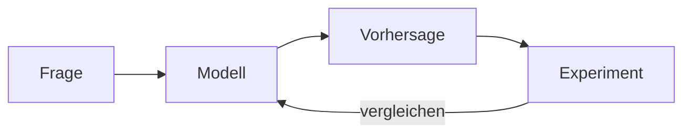

# Titel der Vorlesung

Name der Veranstaltung · Sitzung 1

<!-- Beginne mit einer Frage, die die Studierenden am Ende der Sitzung beantworten können. -->

---

# Inhalt

<Toc />

---
layout: section
---

# Grundlagen

---

# Zentrale Begriffe

- **Begriff eins**: eine kurze Definition
- **Begriff zwei**: eine kurze Definition
- **Begriff drei**: eine kurze Definition

**Merke:** ein Satz, der die Begriffe verbindet.

<!-- Frag nach einem Alltagsbeispiel für jeden Begriff, bevor du deins nennst. -->

---

# Wie es zusammenhängt

<!-- Geh den Kreislauf einmal mit einem konkreten Beispiel durch. -->

---

# Eine Formel

$$
f(x) = a x^2 + b x + c
$$

<v-click>

Das Vorzeichen von $a$ entscheidet, ob die Kurve nach oben oder unten geöffnet ist.

</v-click>

<!-- Zeig zuerst die Formel, dann [click] die zentrale Beobachtung. -->

---
layout: fact
---

# 3

Kernideen, die heute hängen bleiben sollen

---

# Verständnisfrage

<!-- Lass allen 30 Sekunden Bedenkzeit und zeig dann mit Q die Lösung. -->

---

# Zusammenfassung

1. Erste Erkenntnis
2. Zweite Erkenntnis
3. Dritte Erkenntnis

Nächste Sitzung: das nächste Thema

---
layout: end
---

# Fragen?

Sprechstunde und Kontakt
