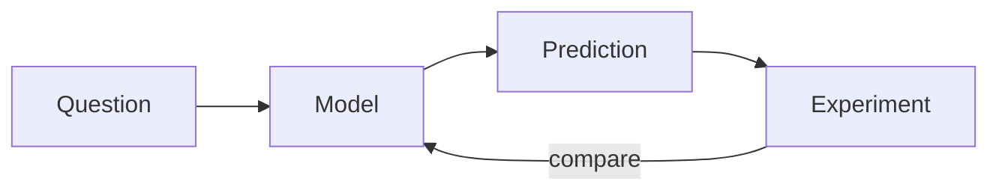

# Lecture title

Course name · Session 1

<!-- Start with a question the students can answer at the end of the session. -->

---

# Contents

<Toc />

---
layout: section
---

# Basics

---

# Key terms

- **Term one**: a short definition
- **Term two**: a short definition
- **Term three**: a short definition

**Remember:** one sentence that ties the terms together.

<!-- Ask for an everyday example of each term before giving yours. -->

---

# How it fits together

<!-- Walk through the cycle once with a concrete example. -->

---

# A formula

$$
f(x) = a x^2 + b x + c
$$

<v-click>

The sign of $a$ decides whether the curve opens up or down.

</v-click>

<!-- Show the formula first, then [click] the key observation. -->

---
layout: fact
---

# 3

key ideas to take away today

---

# Check your understanding

<!-- Let everyone think for 30 seconds, then reveal with Q. -->

---

# Summary

1. First takeaway
2. Second takeaway
3. Third takeaway

Next session: the next topic

---
layout: end
---

# Questions?

Office hours and contact
