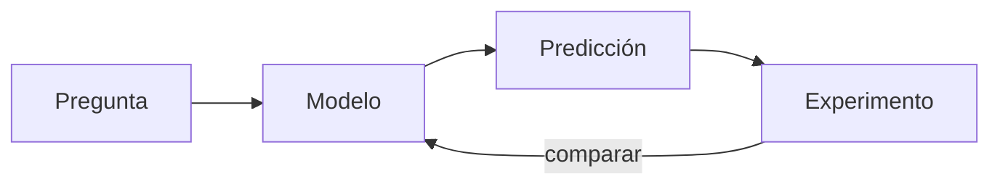

# Título de la clase

Nombre de la asignatura · Sesión 1

<!-- Empieza con una pregunta que los estudiantes podrán responder al final de la sesión. -->

---

# Contenido

<Toc />

---
layout: section
---

# Fundamentos

---

# Conceptos clave

- **Concepto uno**: una definición breve
- **Concepto dos**: una definición breve
- **Concepto tres**: una definición breve

**Recuerda:** una frase que une los conceptos.

<!-- Pide un ejemplo cotidiano de cada concepto antes de dar el tuyo. -->

---

# Cómo encaja todo

<!-- Recorre el ciclo una vez con un ejemplo concreto. -->

---

# Una fórmula

$$
f(x) = a x^2 + b x + c
$$

<v-click>

El signo de $a$ decide si la curva se abre hacia arriba o hacia abajo.

</v-click>

<!-- Muestra primero la fórmula y luego [click] la observación clave. -->

---
layout: fact
---

# 3

ideas clave para llevarse hoy

---

# Comprueba lo que has entendido

<!-- Deja 30 segundos para pensar y luego muestra la solución con Q. -->

---

# Resumen

1. Primera conclusión
2. Segunda conclusión
3. Tercera conclusión

Próxima sesión: el siguiente tema

---
layout: end
---

# ¿Preguntas?

Tutorías y contacto
