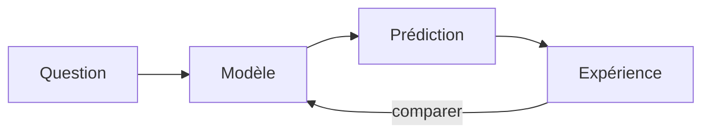

# Titre du cours

Nom de l’enseignement · Séance 1

<!-- Commencez par une question à laquelle les étudiants sauront répondre à la fin de la séance. -->

---

# Sommaire

<Toc />

---
layout: section
---

# Les bases

---

# Notions clés

- **Notion un** : une courte définition
- **Notion deux** : une courte définition
- **Notion trois** : une courte définition

**À retenir :** une phrase qui relie les notions.

<!-- Demandez un exemple du quotidien pour chaque notion avant de donner le vôtre. -->

---

# Comment tout s’articule

<!-- Parcourez le cycle une fois avec un exemple concret. -->

---

# Une formule

$$
f(x) = a x^2 + b x + c
$$

<v-click>

Le signe de $a$ décide si la courbe est tournée vers le haut ou vers le bas.

</v-click>

<!-- Montrez d’abord la formule, puis [click] l’observation clé. -->

---
layout: fact
---

# 3

idées clés à retenir aujourd’hui

---

# Vérifiez votre compréhension

<!-- Laissez 30 secondes de réflexion, puis montrez la solution avec Q. -->

---

# Résumé

1. Premier point à retenir
2. Deuxième point à retenir
3. Troisième point à retenir

Prochaine séance : le sujet suivant

---
layout: end
---

# Des questions ?

Permanence et contact
