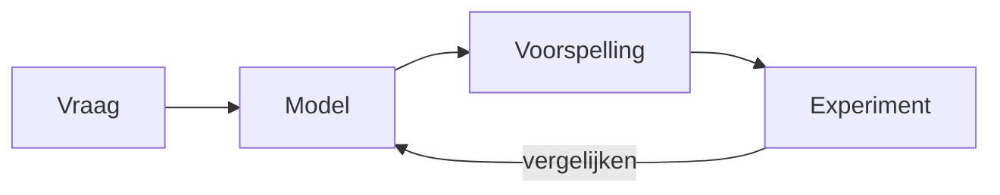

# Titel van het college

Naam van het vak · Bijeenkomst 1

<!-- Begin met een vraag die de studenten aan het eind van de bijeenkomst kunnen beantwoorden. -->

---

# Inhoud

<Toc />

---
layout: section
---

# Basis

---

# Kernbegrippen

- **Begrip één**: een korte definitie
- **Begrip twee**: een korte definitie
- **Begrip drie**: een korte definitie

**Onthoud:** één zin die de begrippen met elkaar verbindt.

<!-- Vraag eerst naar een voorbeeld uit het dagelijks leven bij elk begrip, en geef dan het jouwe. -->

---

# Hoe het samenhangt

<!-- Loop de cyclus één keer door met een concreet voorbeeld. -->

---

# Een formule

$$
f(x) = a x^2 + b x + c
$$

<v-click>

Het teken van $a$ bepaalt of de grafiek naar boven of naar beneden opent.

</v-click>

<!-- Laat eerst de formule zien, dan [click] de belangrijkste observatie. -->

---
layout: fact
---

# 3

kernideeën om vandaag te onthouden

---

# Begrijp je het?

<!-- Geef iedereen 30 seconden bedenktijd en toon dan het antwoord met Q. -->

---

# Samenvatting

1. Eerste inzicht
2. Tweede inzicht
3. Derde inzicht

Volgende bijeenkomst: het volgende onderwerp

---
layout: end
---

# Vragen?

Spreekuur en contact
